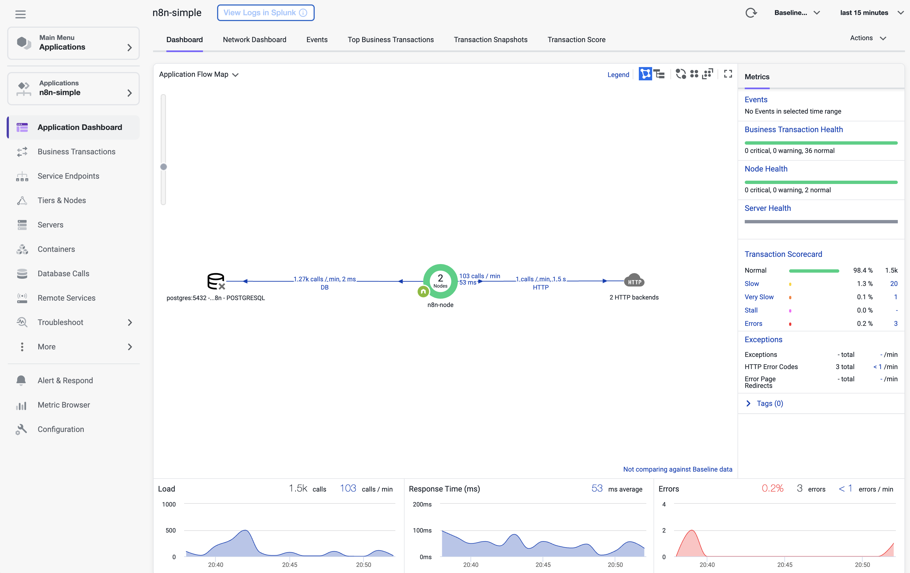
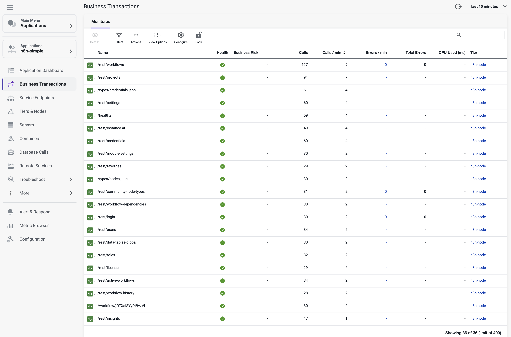
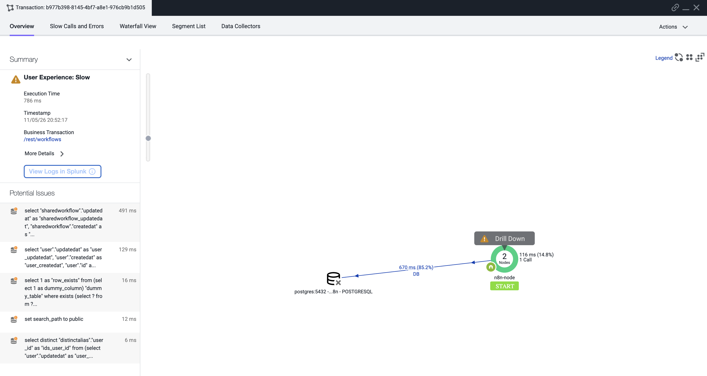

# n8n AppDynamics examples

[n8n](https://n8n.io/) is a workflow automation platform for connecting apps,
APIs, and services through a visual editor, with support for custom JavaScript
and Python code. It can be self-hosted or used through n8n Cloud.
**These instrumentation examples are for self-hosted n8n only, not n8n Cloud.**

This repository provides examples of instrumenting n8n and its task runners
with AppDynamics. Each example has its own Compose project, database, secrets,
networks, and named volumes. All default to editor port 5678; run one at a time,
or set distinct `N8N_HTTP_PORT` values to run them side by side.

> **Instrumentation scope and disclaimer.** The [simple example](./n8n-simple/README.md)
> demonstrates standard AppDynamics Node.js agent instrumentation of the n8n
> editor/API process.
>
> **Task-runner instrumentation is intended for educational purposes only and
> is not recommended for production use.** n8n task runners execute user code
> in a [security-restricted environment](https://docs.n8n.io/deploy/host-n8n/configure-n8n/basic-configuration/use-environment-variables/task-runners).
> The JavaScript runner examples relax sandbox protections for instrumentation
> compatibility. The Python example preserves those protections but uses custom
> instrumentation outside the sandbox.
>
> This is an independent, community-created project, not an official integration
> supported, certified, or endorsed by Cisco, Splunk, or AppDynamics. It is
> provided "as is" without warranty.

## AppDynamics in action

The following Controller captures show the [simple example](./n8n-simple/README.md)
reporting HTTP business transactions, backend calls, and transaction snapshots
under application `n8n-simple` and tier `n8n-node`. This demonstrates captured
application activity, beyond agent registration alone.

### Application flow map

The dashboard shows the instrumented n8n tier communicating with PostgreSQL and
HTTP backends, alongside request volume, response time, and error metrics.

[](./appd-n8n-dashboard.png)

<details>
<summary><strong>Business transactions: editor and API requests</strong></summary>

Requests such as `/rest/workflows`, `/rest/projects`, and `/rest/settings` appear
as monitored business transactions with call counts, health, and error metrics.
These are HTTP entry points in the main n8n process, not task-runner BT names.

[](./appd-n8n-bts.png)

</details>

<details>
<summary><strong>Transaction snapshot: database time breakdown</strong></summary>

A slow `/rest/workflows` request includes a response-time breakdown and individual
SQL calls. In this captured request, database activity accounts for about 85% of
the response time, helping identify where to investigate latency.

[](./appd-n8n-snapshot.png)

</details>

Click any image to view it at full resolution. Counts and timings describe the
captured workload, not a performance benchmark. These screenshots demonstrate
main-process instrumentation; they do not demonstrate external-runner correlation
or browser-side monitoring.

## Choose an example

| Example | Runner arrangement | Instrumentation | Default editor port | Compose project |
| --- | --- | --- | --- | --- |
| [n8n-simple](./n8n-simple/README.md) | Internal JavaScript runner, a child of n8n | Node.js agent in main n8n only by default; runner instrumentation is opt-in | 5678 | `n8n-simple` |
| [n8n-ext-runner-nodejs](./n8n-ext-runner-nodejs/README.md) | Official external task-runner container | Node.js agent in n8n and the JavaScript runner; Python is not instrumented | 5678 | `n8n-ext-runner-nodejs` |
| [n8n-ext-runner-python](./n8n-ext-runner-python/README.md) | Custom external Python-only runner and separate agent proxy | Node.js agent in n8n; Python agent around runner task execution | 5678 | `n8n-ext-runner-python` |

The explicit Compose project names and AppDynamics application defaults match
their example directory names.

## AppDynamics environment configuration

Agent settings live in each example's `.env`, using the same standard
`APPDYNAMICS_*` names that Compose forwards to the container. Required settings
fail Compose validation if missing; defaults are documented in `.env.example`
rather than hardcoded into the service environment.

| Setting | Default in each template |
| --- | --- |
| `APPDYNAMICS_AGENT_APPLICATION_NAME` | `n8n-simple`, `n8n-ext-runner-nodejs`, or `n8n-ext-runner-python` |
| `APPDYNAMICS_AGENT_TIER_NAME` | `n8n-node` for main n8n |
| `APPDYNAMICS_AGENT_NODE_NAME` | `n8n-node` |
| `APPDYNAMICS_AGENT_REUSE_NODE_NAME_PREFIX` | `n8n-node` |
| `APPDYNAMICS_CONTROLLER_PORT` | `443` |
| `APPDYNAMICS_CONTROLLER_SSL_ENABLED` | `true` |
| `APPDYNAMICS_LOGGER_OUTPUT_TYPE` | `console` |

Set `APPDYNAMICS_AGENT_ACCOUNT_NAME`, `APPDYNAMICS_AGENT_ACCOUNT_ACCESS_KEY`,
and `APPDYNAMICS_CONTROLLER_HOST_NAME` to your Controller connection values.
These are blank in templates. The external setup scripts copy only standard
connection settings (including port and SSL mode), the agent image setting,
and the CA from a source; they do not copy its application/tier/node identity.

External runners use tier **`n8n-runner`** so the main and runner tiers remain
distinct. The two optional example-specific controls are:

```dotenv
N8N_APPDYNAMICS_TASK_RUNNER_TIER_NAME=n8n-runner
N8N_APPDYNAMICS_TASK_RUNNER_REUSE_NODE_NAME_PREFIX=
```

Compose maps these to the standard runner tier/prefix variables; empty overrides
inherit the main values. Both processes use `APPDYNAMICS_AGENT_NODE_NAME=n8n-node`
and, by default, the `n8n-node` reuse prefix. With node reuse enabled, the agent
and Controller assign the actual reused node names; an exact displayed name is
not guaranteed. In the simple example, runner overrides have no effect unless
its optional custom-shim setup is enabled.

Python proxy communication, certificate-path, and logging settings also use
standard variables in its `.env`. `APPDYNAMICS_TCP_COMM_HOST` and
`APPDYNAMICS_TCP_COMM_PORT` are shared by the runner and proxy. Keep the default
loopback host for their shared network namespace. `APPDYNAMICS_LOGGING_LEVEL`
controls both Python and proxy logging (`info` by default).
`APPDYNAMICS_CONTROLLER_SSL_CERTFILE` is a container path; both Python containers
mount the CA at that path. Keep `APPDYNAMICS_LOGS_DIR` under writable `/tmp`.
`APPD_INIT_IMAGE` and `APPD_PYTHON_PROXY_IMAGE` select container images; they are
example-specific Compose settings, not agent environment aliases.

The AppDynamics container image defaults are:

```dotenv
APPD_INIT_IMAGE=docker.io/appdynamics/nodejs-agent:latest
# Python example only; pinned alongside the Python pip package:
APPD_PYTHON_PROXY_IMAGE=docker.io/appdynamics/dl-proxy:26.7.2
```

`:latest` is a moving tag, not a fixed or newly validated Node.js agent version.
Recheck instrumentation after pulling updated images. The Python pip package
remains pinned in [requirements.txt](./n8n-ext-runner-python/requirements.txt);
it is installed into the custom runner, not selected by a vendor image tag.
Its proxy stays on the matching `26.7.2` release; the pip package includes the
additional build suffix (`26.7.2.9185`). n8n and its matching runner image also
remain pinned. Explicit image settings in `.env` or copied by the setup scripts
override the defaults.

Do not overwrite an existing `.env` with the template or regenerate database,
encryption, or broker secrets. Validate with `./deploy.sh <example> config`,
then use `./deploy.sh <example>` when ready to apply the changes.

## What runs in a task runner?

Task runners execute user code requested by Code nodes, not entire workflows.
A JavaScript Code node uses a JavaScript runner; a native Python Code node uses
a Python runner. Standard nodes such as HTTP Request, AI Agent, and OpenAI Chat
Model run in the main n8n process.

External runners start on demand. Run the corresponding Code-node smoke workflow
to start the language process. `N8N_RUNNERS_AUTO_SHUTDOWN_TIMEOUT=0` keeps a
started runner alive while idle; it does not start one eagerly. A healthy
launcher alone is not proof that a language runner or its AppDynamics agent is
running or reporting.

## Instrumentation method and scope

### Main-process instrumentation: n8n-simple

- An init service copies the Node.js agent into a named volume.
- n8n preloads the stock shim from that volume through `NODE_OPTIONS`. An
  unmodified reference copy is saved as [shim.orig.js](./n8n-simple/shim.orig.js).
- Only the main n8n process (editor/API and other main-process work) is
  instrumented by default. Task runners retain their default sandbox protections.
- The custom [shim.js](./n8n-simple/shim.js) and its runner spawn hook are retained
  but disabled: the bind mount and optional runner settings are commented out.
  Opting into runner instrumentation requires the insecure compatibility mode
  described in the example guide.
- Main-process naming remains configurable through standard agent variables;
  runner-specific overrides apply only when the optional hook is enabled.
- No task-specific BT naming template or explicit per-task cross-tier
  correlation adapter is implemented.

### External JavaScript: n8n-ext-runner-nodejs

- Main n8n preloads the Node.js agent from its own agent volume.
- [n8n-task-runners.json](./n8n-ext-runner-nodejs/n8n-task-runners.json)
  explicitly preloads the same shim in the external JavaScript process and
  allowlists its agent environment variables. No internal spawn hook is needed.
- JavaScript user code executes in the runner's Node.js process. Instrumentation
  coverage depends on supported libraries and execution paths; agent registration
  alone does not prove that every call is traced.
- The launcher's Python configuration retains isolated execution but does not
  load a Python agent.
- Configurable task BT names and explicit per-task correlation have been
  investigated as feasible, but are **not implemented in this example**.

### External Python: n8n-ext-runner-python

- Main n8n uses the Node.js agent.
- A custom amd64/glibc Python image loads the Python agent through
  [bootstrap.py](./n8n-ext-runner-python/bootstrap.py), retaining Python's isolated
  startup flags. A separate `dl-proxy` shares the runner's network namespace.
- The Python agent runs in the runner's parent process, **outside the sandbox**.
  It measures parent-side task execution/wait duration, not individual calls or
  outbound requests inside the sandboxed Python subprocess.
- Configurable names use `N8N_APPDYNAMICS_BT_NAME_TEMPLATE`, defaulting to
  `n8n/{workflow_name}/{node_name}`. Supported fields are workflow/node names and
  IDs; task and execution IDs belong in snapshot metadata.
- Optional correlation sends an SDK-generated value in each task's settings
  over n8n's existing WebSocket transport. It is not a connection-level header.
  Correlated segments retain the upstream BT identity, with the configured task
  name available in snapshot data.
- `N8N_APPDYNAMICS_CORRELATION_ENABLED=false` disables the Node task-correlation
  hook without disabling independently named Python transactions. Correlation
  is best-effort; Python falls back to an independent BT if it cannot continue
  the upstream transaction.
- Python agent readiness remains required: a task fails explicitly if no
  transaction handle becomes available within 60 seconds.

See the individual guides for compatibility details and validation evidence.
The Python image follows the manual-proxy approach in the
[Python sidecar example](../python-sidecar-init-container/).

## Security and compatibility

These are development examples, not production-hardening or support
certifications.

- The simple example keeps default runner protections and instruments only main
  n8n. Its optional runner instrumentation and the external JavaScript example
  use **insecure runner compatibility mode** because n8n's JavaScript sandbox
  restricts features used by instrumentation and some external libraries.
  This is not a limitation defined by a particular AppDynamics agent version.
  The [n8n task-runner environment reference](https://docs.n8n.io/deploy/host-n8n/configure-n8n/basic-configuration/use-environment-variables/task-runners)
  documents `N8N_RUNNERS_INSECURE_MODE` and gives Puppeteer as an example under
  `N8N_RUNNERS_ALLOW_PROTOTYPE_MUTATION`. See the
  [JavaScript guide](./n8n-ext-runner-nodejs/README.md#why-not-n8n_runners_allow_prototype_mutation)
  for the distinction between those settings in the pinned n8n release.
  Use insecure mode only for trusted workflows. Moving the runner into a
  separate container does not remove its JavaScript sandbox restrictions.
- The Python example retains secure-mode restrictions, empty module allowlists,
  isolated subprocess execution, and container-level protections. It does not
  inject the agent into the sandbox.
- The custom hooks and images are version-dependent. Recheck them when upgrading
  n8n, its matching runner image, or the agents.
- Keep each example's private `.env` and CA certificate local. Do not regenerate
  database/encryption secrets for an existing deployment.
- Every example includes a credential-free `.env.example`. Git ignore rules
  exclude `.env`, other `.env.*` files, and the entire `certs/` directory while
  explicitly allowing `.env.example`. Ignore rules do not untrack files that
  were already committed; check the index before publishing a repository.

## Run and test

Use Bash and either Podman Compose (with a running Podman machine on macOS/Windows)
or Docker Compose. Node.js 20.12+ is needed for initialization and tests. The Python
runner requires amd64 execution; native x86_64 Linux is recommended for testing
its native agent.

### Build and deploy

Pass an example's directory name to [build.sh](./build.sh) and
[deploy.sh](./deploy.sh). Paths are resolved relative to the scripts, not your
current working directory. From this directory:

```sh
./build.sh --help
./deploy.sh --help
./build.sh n8n-simple
./deploy.sh n8n-simple
```

Replace `n8n-simple` with `n8n-ext-runner-nodejs` or `n8n-ext-runner-python` to
select another example. Configure its private environment and CA before building.
All examples use port 5678 by default, so start only one unless you override ports.

- **Build:** validates Compose configuration and pulls prebuilt service images.
  For Python, it also builds the custom `task-runners` image. It starts no services.
- **Deploy:** defaults to `up`, using prepared images without building or pulling.
  Run the build script first, and again after changing images or Python build
  inputs. Deployment failures are reported without switching runtimes or retrying.
- Both scripts require an explicit, recognized example name.

The scripts select the first reachable runtime with working Compose, trying
**Podman before Docker**. Skipped runtimes and the selected runtime are reported.
To avoid ambiguity when both are running, set `CONTAINER_RUNTIME=podman` or
`CONTAINER_RUNTIME=docker` consistently for both commands. An explicit selection
never falls back to the other runtime:

```sh
CONTAINER_RUNTIME=docker ./build.sh n8n-ext-runner-python
CONTAINER_RUNTIME=docker ./deploy.sh n8n-ext-runner-python
```

Other deployment actions:

```sh
./deploy.sh n8n-simple config  # validate without printing credentials
./deploy.sh n8n-simple ps      # show status
./deploy.sh n8n-simple logs    # follow recent logs
./deploy.sh n8n-simple stop    # preserve containers and data
./deploy.sh n8n-simple down    # remove stack, preserve named volumes
```

From the outer examples directory, use
`./n8n-appd-examples/deploy.sh n8n-simple` (and the corresponding build path).
Use direct Compose commands from the example directory for operations not exposed
by these scripts, such as force-recreating services after editing a mounted shim.

### Initialize a new configuration

The external examples retain their existing setup scripts. From this directory,
optionally copy only Controller connection settings and the CA from the simple
example:

```sh
node n8n-ext-runner-nodejs/setup-env.js n8n-simple/.env
node n8n-ext-runner-python/setup-env.js n8n-simple/.env
```

Omit the source argument to configure the connection and CA yourself. The source
path is relative to your current working directory; the generated files always
go into the setup script's example directory. These commands generate independent
secrets and refuse to overwrite existing configuration. Skip initialization for
existing deployments. Follow the [simple example guide](./n8n-simple/README.md)
for its manual setup.

### Tests

From this directory:

```sh
NODE_OPTIONS= node --test scripts.test.js */*.test.js
```

Script tests use fake container runtimes; they do not start services or contact
the Controller. The other JavaScript tests are also isolated from the Controller.
Run the additional Python tests in the built image as described in the
[Python example guide](./n8n-ext-runner-python/README.md#tests-and-smoke-workflow).

## License

Original project code and documentation are licensed under the
[MIT License](./LICENSE). Third-party software, the copied
vendor initialization reference, and product materials retain their respective
terms; see [Third-party notices](./THIRD_PARTY_NOTICES.md).
